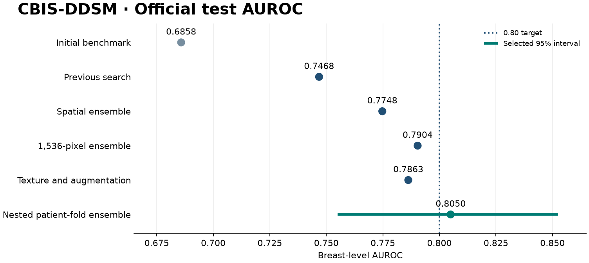
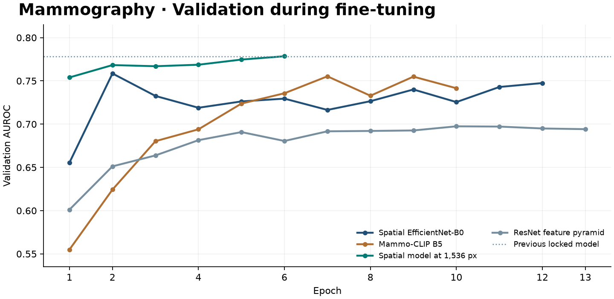

# Mammography discrimination and model selection

| Official test experiment | AUROC | Average precision |
| --- | ---: | ---: |
| Initial benchmark | 0.6858 | 0.6372 |
| Previous model search | 0.7468 | 0.7073 |
| Spatial model and Mammo-CLIP | 0.7748 | 0.7324 |
| 1,536-pixel spatial model and Mammo-CLIP | 0.7904 | 0.7542 |
| Texture and deterministic augmentation | 0.7863 | 0.7507 |
| Nested patient-fold ensemble | **0.8050** | **0.7762** |

The selected ensemble gained **+0.0582 AUROC** over the previous search, with a paired 95% interval of +0.0199 to +0.0971 across 1,000 patient bootstrap resamples. Compared with the 1,536-pixel round, the gain was +0.0146 with a paired interval of −0.0048 to +0.0340. Brier score went from 0.1998 to 0.1745 relative to the previous search.

The test comprises 336 breasts from 316 patients. The selected model's AUROC interval is 0.7550–0.8524. Its point estimate exceeds 0.80 and its interval includes 0.80.

## Training and model selection

Training uses 1,039 breasts and 2,105 geometrically aligned mammogram lesion marks. Four benign and malignant morphology combinations teach the spatial head. The original split audit groups by patient and resolves conflicting records and image links. The evaluation takes whole-view pixels and view availability.

The first follow-up selected an equal blend of the previous model, a spatial EfficientNet-B0 and a Mammo-CLIP B5 model. It reached 0.8267 validation AUROC. The second compared 136 recipes and added a 1,536-pixel refinement with synchronized intensity and geometric augmentation. The equal blend selected on 260 validation breasts reached 0.8352 AUROC. The third compared 1,056 recipes and selected a texture and deterministic-augmentation blend with 0.8390 validation AUROC.

The fourth round introduced a separate RSNA-pretrained image encoder and view-level training supervision. It recorded 397 validation recipes and selected among four policies that fitted ensemble weights on patient-disjoint validation folds. The selected policy averages weights learned across 15 folds from three seeded five-fold partitions. Its out-of-fold blend score was 0.8200 AUROC and 0.8142 average precision on the validation cohort.

| Selected component | Blend weight |
| --- | ---: |
| Previous locked ensemble | 32.06% |
| RSNA breast-cancer transfer | 22.12% |
| 1,536-pixel model with deterministic augmentation | 12.40% |
| Projection-supervised model | 9.02% |
| Mammo-CLIP with spatial supervision | 7.08% |
| Mass and calcification specialists | 6.95% |
| Patient-cross-fitted patch attention | 6.51% |
| 1,536-pixel model with original preprocessing | 3.86% |

Each round locked its model, blend and calibration before scoring the same official test benchmark. The benchmark was reused across this sequence of experiments. The reported intervals describe uncertainty on this cohort and performance on new acquisition settings remains unmeasured.

## Performance by lesion type

| Reference lesion type | Breasts | AUROC |
| --- | ---: | ---: |
| Mass | 190 | 0.8602 |
| Calcification | 146 | 0.7341 |

The lesion categories in this table are evaluation subgroups. The selected classifier takes one or two full projections. The endpoint is malignancy in a lesion-enriched cohort.

## Reproduce and predict

The [reproduction guide](REPRODUCE.md) lists the exact training settings for each final-round candidate, the validation lock, the official evaluation, and prediction commands. The [synthetic examples](examples/README.md) show the calibrated output for paired CC and MLO projections and for CC alone.
