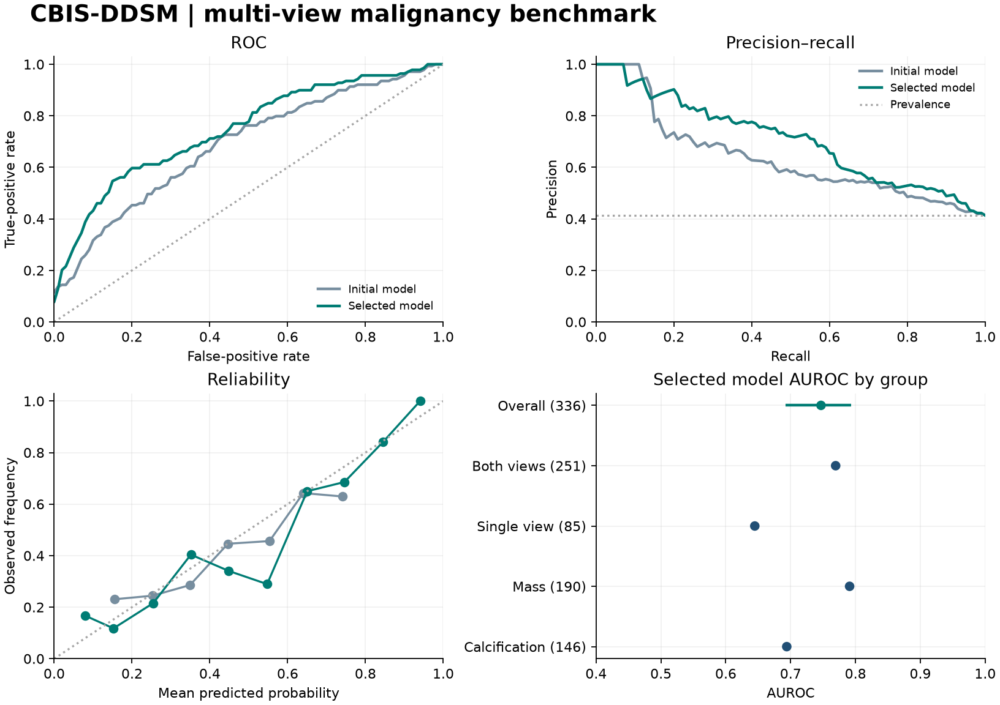
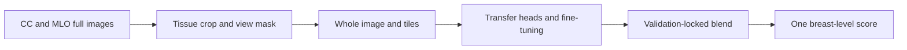

# CBIS-DDSM Multi-View Mammography

Multi-view and multi-instance classification of malignancy in a lesion-enriched mammography cohort.

**0.7468 AUROC** versus 0.6858 in the initial run, evaluated on the same 336 test units.

Selected configuration `incumbent+adapted-dino-224-0.25`. See the [experiment report](REPORT.md), [search trajectories](figures/search.png), [aggregate metrics](metrics.json), and [synthetic prediction example](examples/README.md).



## Dataset

| Partition | Breasts | Patients |
| --- | ---: | ---: |
| Train | 1,039 | 961 |
| Validation | 260 | 240 |
| Official test | 336 | 316 |

The cohort groups patients across mass and calcification annotations and repairs 282 test image links. The model accepts either one projection or both. The endpoint applies to breasts selected for an annotated lesion. [TCIA collection](https://www.cancerimagingarchive.net/collection/cbis-ddsm/) · [Data descriptor](https://doi.org/10.1038/sdata.2017.177) · [Local-format dataset](https://www.kaggle.com/datasets/awsaf49/cbis-ddsm-breast-cancer-image-dataset)

## Workflow



The project uses a pinned [shared training engine](https://github.com/ThorsenH1/medimage-ml-lab) and has a task-specific runner. The published artifact contains source, aggregate benchmark results, and synthetic examples. Dataset files, checkpoints, and individual evaluation predictions stay in local storage.

## Reproduce the experiment

Use Python 3.11, PowerShell 7, and a CUDA-capable GPU. The original workstation used an RTX 2080 SUPER with 8 GiB VRAM.

```powershell
python -m venv .venv
$p = './.venv/Scripts/python.exe'
& $p -m pip install torch==2.14.0+cu126 torchvision==0.29.0+cu126 --index-url https://download.pytorch.org/whl/cu126
& $p -m pip install -r requirements.txt
```

Set the data and pretrained weight locations for your machine. The initial ResNet-18 weight directory uses `hub/checkpoints/resnet18-f37072fd.pth`. The Hugging Face cache uses `refs/main` and `snapshots/<revision>/model.safetensors`. Use the Hugging Face snapshots for `timm/efficientnet_b0.ra_in1k`, `timm/resnet50.a1_in1k`, and `timm/vit_small_patch14_dinov2.lvd142m`. [Initial ResNet-18 weights](https://download.pytorch.org/models/resnet18-f37072fd.pth)

```powershell
$data = 'D:/datasets/mammo'
$torchCache = 'D:/models/torch'
$hf = 'D:/models/huggingface/hub'
pwsh -File scripts/Run-Project.ps1 -Task mammo -Python $p -DataRoot $data -InitialWeights $torchCache -WeightRoot $hf
```

The runner writes the initial experiment under `artifacts/` and the extended search under `search-artifacts/`. For a larger volume, supply `-Artifacts` and `-Search` and use matching paths at inference. The prepared caches and training stages can resume from saved boundaries.

## Predict from raw input

Use the model selection and checkpoint roots produced by the runner.

```powershell
& $p -m medimage.search_predict radiography --selection search-artifacts/evaluation/mammo/selection.json --search search-artifacts/runs/mammo --weights $hf --original artifacts --cc 'C:/images/cc.jpg' --mlo 'C:/images/mlo.jpg' --output search-artifacts/inference/mammo.json
```

The [example](examples/README.md) runs the selected local models on deterministic synthetic inputs. This is a research and education project.
