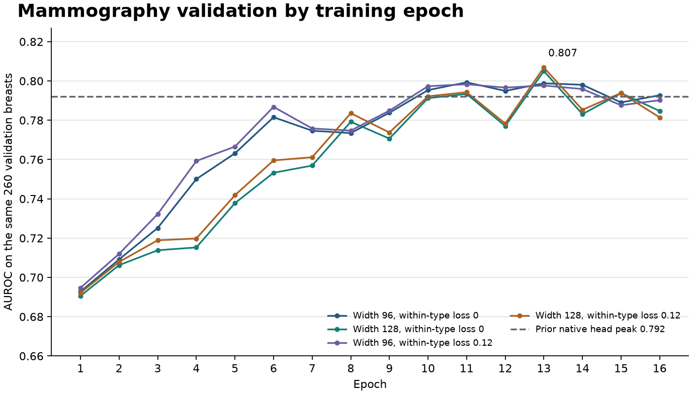

# Improving the mammography model

The current selected ensemble reached **0.8050 breast-level AUROC**. Mass cases reached **0.8602** and calcification cases reached **0.7341**. Calcifications can occupy only a small part of an image. Resizing an entire breast can make their margins and distribution harder to see. [Current benchmark](AUROC.md)

## What a full-resolution external model contributed

GMIC combines a whole-image model with a second branch that reads proposed 256 × 256 pixel regions. Its layout lets it see fine detail without running the entire image through the expensive patch model. The pilot tested the first published checkpoint on 467 whole CC or MLO projections from 260 validation breasts. We aligned the chest wall, preserved the aspect ratio, and used image-wide standardization. Each view used a 2,944 × 1,920 pixel canvas. [GMIC source and weights](https://github.com/nyukat/GMIC) · [Published method](https://arxiv.org/abs/2002.07613)

| Pooling rule for the external checkpoint | Validation AUROC | Average precision |
| --- | ---: | ---: |
| Average of available view logits | 0.5864 | 0.5823 |
| Maximum over available view logits | 0.5615 | 0.5741 |

This pilot measures transfer from one published checkpoint to this cohort with the stated preparation. The low score motivated a detector trained on our own development images. The official test was unused in this pilot.

## Learn small details from project training data

The detector reads a tissue crop, plus two versions that emphasize differences from the local average. Small fields of view preserve the shape of calcifications. Larger fields cover the structure of masses. Training uses lesion annotations from training patients to teach the detector. At prediction time a dense scan of the two whole views proposes candidate patches.

The breast-level classifier learns to combine patch evidence across views. Every training breast receives proposed patches from a detector that excluded its patient group. The strongest standalone version reached **0.7964 validation AUROC**. The blend search compared **524 recipes** and selected a new version with **0.8350 cross-fitted validation AUROC**.

| Same official test cohort | Published eight-model ensemble | New fine-texture candidate |
| --- | ---: | ---: |
| Breast-level AUROC | **0.8050** | 0.7882 |
| Average precision | **0.7762** | 0.7578 |
| Mass AUROC | **0.8602** | 0.8440 |
| Calcification AUROC | **0.7341** | 0.7180 |

The change was **−0.0168 AUROC**, with a paired 95% interval of **−0.0345 to +0.0002**. This experiment gives a concrete example of a higher validation score that fails to transfer to the familiar test cohort. The published ensemble remains the one described in the [main report](AUROC.md).

### Reproduce the fine-texture candidate

Use the same `$p`, `$cohort`, `$pixels1536`, `$hf` and `$runs` as the [main training guide](REPRODUCE.md).

```powershell
& $p -m medimage.auc_mammo_mil --cohort $cohort --pixels $pixels1536 --weights $hf `
    --output "$runs/mammo-fine-texture" --patch-epochs 8 --epochs 18 --seed 5183 --fine-texture
```

Add the candidate `fine-texture-mil=runs/mammo-fine-texture@mammo-spatial1536` to the existing candidate list. Write the new validation lock in another evaluation directory before scoring the official test.

## A second source of breast images

The Chinese Mammography Database contains digital mammograms and biopsy-confirmed labels. It gives the experiment a way to learn from a second source and to reserve separate patients for evaluation. The data use different acquisition equipment from CBIS-DDSM. Transfer between the two is a research question. [CMMD data and citation](https://doi.org/10.7937/tcia.eqde-4b16)

The CMMD cache starts from 5,202 DICOM files. We group images by patient and breast side and keep standard CC and MLO projections. A fixed patient split produced 1,242 training breasts, 275 validation breasts and 350 test breasts. The duplicate audit excluded five breasts from patients linked by repeated images. The CBIS-only EfficientNet starts from the checkpoint used in the main project. The CMMD-adapted version starts there too, then learns from CMMD training patients. CMMD validation selected epoch 6 of 7.

| Configuration on the same 350 CMMD breasts from 336 test patients | AUROC | 95% patient bootstrap interval | Average precision |
| --- | ---: | ---: | ---: |
| CBIS-only, external evaluation | 0.7271 | 0.6669–0.7862 | 0.8826 |
| CMMD-adapted, held-out patients from the adaptation dataset | **0.8415** | **0.7974–0.8807** | **0.9404** |

The paired change in AUROC was +0.1143 with a 95% interval of +0.0614 to +0.1703. This compares complete configurations at input heights of 1,536 and 1,280 pixels. The test set contains 260 malignant and 90 benign breasts, which gives average precision a prevalence baseline of 0.7429. The project's separate official CBIS-DDSM benchmark is reported above.

### Does CMMD adaptation improve the CBIS-DDSM model?

I started from the CMMD-adapted checkpoint and fitted it again on CBIS-DDSM training breasts at an input height of 1,536 pixels. The new branch reached **0.7785 validation AUROC**. A search across 675 configurations chose the final blend on patient-grouped validation. Its validation AUROC was **0.8332**, and its CMMD branch weight was **2.24%**. The complete model was locked before running the official CBIS-DDSM test.

| Metric on the same 336 breasts from 316 test patients | Published ensemble | CMMD-transfer blend |
| --- | ---: | ---: |
| AUROC | **0.8050** | 0.7882 |
| Average precision | **0.7762** | 0.7574 |
| Brier score, lower is better | **0.1745** | 0.1846 |
| Mass AUROC | **0.8602** | 0.8435 |
| Calcification AUROC | **0.7341** | 0.7174 |

The blend's 95% patient-bootstrap AUROC interval was **0.7359–0.8330**. The published CBIS-DDSM model remains the model with 0.8050 AUROC. The held-out CMMD gain above measures adaptation to CMMD patients. This experiment measures the result of transferring the adapted model back to CBIS-DDSM.

Using matched resamples of the same 316 test patients, the AUROC change was **−0.0168**, with a paired 95% interval of **−0.0349 to +0.0004**. Average precision changed by **−0.0188**, with a paired interval of **−0.0371 to −0.0013**.

### Reproduce the CMMD comparison

Download the DICOM release and its clinical spreadsheet from TCIA. Keep the `$p`, `$hf`, `$experiment` and `$runs` variables and the trained sharp checkpoint from the [main reproduction guide](REPRODUCE.md).

```powershell
$cmmdDicom = 'D:/data/CMMD/dicom'
$cmmdLabels = 'D:/data/CMMD/clinical.xlsx'
$cmmdCache = "$experiment/cmmd/cache1536"
& $p -m medimage.mammo_cmmd --dicom $cmmdDicom --labels $cmmdLabels --output $cmmdCache `
    --height 1536 --workers 5 --expected 5202
& $p -m medimage.auc_train mammo --cohort $cmmdCache --pixels $cmmdCache --backbone effb0 --weights $hf `
    --parent "$runs/mammo-sharp1536/best.pt" --domain-parent --output "$runs/cmmd-effb0" `
    --epochs 7 --batch 3 --accumulate 5 --resolution 1280 --depth 3 --lr 0.000065 --head-lr 0.00024 `
    --class-power 0.23 --dropout 0.38 --seed 5333
& $p -m medimage.mammo_cmmd_evaluate --cohort $cmmdCache --work $experiment --weights $hf `
    --output "$experiment/cmmd/evaluation"
& $p -m medimage.auc_train mammo --cohort $cohort --pixels $pixels1536 --backbone effb0 --weights $hf `
    --parent "$runs/cmmd-effb0/best.pt" --domain-parent --output "$runs/mammo-cmmd-transfer" `
    --epochs 6 --batch 2 --accumulate 8 --resolution 1536 --depth 3 --auxiliary 0.34 `
    --lr 0.000042 --head-lr 0.00015 --class-power 0.24 --dropout 0.38 --seed 5365 --block 128 --affine
```

Extend the [published validation search](REPRODUCE.md#lock-on-validation-then-run-the-official-test) with the fine-texture candidate above and `cmmd-transfer=runs/mammo-cmmd-transfer@mammo-spatial1536`. Use a new evaluation directory and keep the patient-grouped calibration and blend settings.

## Keeping small grayscale changes from the original images

The current model reads 8-bit JPEGs. The public archive also has the original mammograms. In a pilot, I matched 24 training CC views to their DICOM originals and checked the same annotated regions in both versions. The files had the same image dimensions and orientation in all 24 pairs. All originals stored 16-bit pixels.

| Median within the annotated region | Original DICOM | JPEG |
| --- | ---: | ---: |
| Distinct gray levels in 12 mass views | 949 | 80 |
| Distinct gray levels in 12 calcification views | 1,067.5 | 97 |

After matching the brightness scale, the median local texture correlation was 0.791 for mass regions and 0.811 for calcification regions. The pilot measures differences in the image signal. The breast-level evaluation measures whether the extra signal improves predictions. [Original CBIS-DDSM archive](https://www.cancerimagingarchive.net/collection/cbis-ddsm/) · [NCI Imaging Data Commons](https://datacommons.cancer.gov/repository/imaging-data-commons)

### Reproduce the high-precision candidate

The complete native-precision cache contains **1,635 breasts**. I verified the file sizes for all **2,897 original DICOM projections** before processing. The registry assigned 1,843 projections to training, 467 to validation, and 587 to the official test using the existing split. The preparation command keeps native precision through alignment and resizing, and adds a smaller contrast-enhanced component for compatibility with the starting model. It matched **1,007 of 1,007** training mass annotations and **1,101 of 1,102** training calcification annotations. One calcification annotation had no unambiguous match. The raw data require around 96 GB and the 16-bit cache requires around 10 GB.

I verified the full reader, training and prediction path on four original projections from the project's training partition. Running inference directly from the two DICOM files used for smoke validation reproduced both cached logits. Full-cohort performance is measured separately on the published CBIS-DDSM split.

```powershell
& $p -m pip install 'idc-index==0.13.5' 'idc-index-data==25.0.5'
$nativeRoot = "$experiment/native-mammograms"
$dicomPlan = "$nativeRoot/registry.json"
$nativeDicom = "$nativeRoot/dicom"
$nativePixels = "$experiment/pixels/mammo-native1536"
& $p -m medimage.mammo_native_registry plan --cohort $cohort --project-root $data --plan $dicomPlan
& $p -m medimage.mammo_native_registry download --plan $dicomPlan --destination $nativeDicom
& $p -m medimage.mammo_native --cohort $cohort --plan $dicomPlan --dicom $nativeDicom `
    --project-root $data --output $nativePixels --height 1536 --workers 4
& $p -m medimage.auc_train mammo --cohort $cohort --pixels $nativePixels --backbone effb0 --weights $hf `
    --parent "$runs/mammo-view-supervised/best.pt" --output "$runs/mammo-native1536" --view-supervision `
    --epochs 6 --batch 2 --accumulate 8 --resolution 1536 --depth 3 --auxiliary 0.31 `
    --lr 0.000040 --head-lr 0.000145 --class-power 0.21 --dropout 0.38 --seed 5701 --block 112 --affine
```

Add `native1536=runs/mammo-native1536@mammo-native1536` to the validation candidate list. The locked test command reads the matching original DICOM projections for this component. To reproduce a mixed-format prediction from files, supply the matching DICOM projections through `--native-cc` and `--native-mlo`, along with the JPEG projections required by the other components.

### What changed on the official test?

The original-image component reached its highest validation AUROC after **one epoch of six**, at **0.7988**. The later epochs lowered training loss while validation AUROC fell. The selection compared **852 recipes** and locked a blend with **17.5%** weight on the native-image component and **0.8283** patient-grouped validation AUROC. I evaluated that fixed blend on the same official test breasts as the published model.

| Metric across 336 breasts from 316 test patients | Published ensemble | Blend with original DICOMs |
| --- | ---: | ---: |
| AUROC | **0.8050** | 0.7894 |
| Average precision | **0.7762** | 0.7561 |
| Brier score, lower is better | **0.1745** | 0.1840 |
| Mass AUROC | **0.8602** | 0.8429 |
| Calcification AUROC | **0.7341** | 0.7233 |

The 95% patient-bootstrap interval for the new blend was **0.7396–0.8351**. The paired AUROC change was **−0.0156**, with a 95% interval of **−0.0376 to +0.0072**. The published model remains the **0.8050** ensemble. This comparison tests the full blend, including how validation chose the weights. [See where the existing model places its strongest image regions](WHERE-THE-MODEL-LOOKS.md)

## Train a patch detector on the original images

The whole-breast DICOM model still shrinks local patterns before the final prediction. This experiment cuts small patches from the aligned 16-bit images, then lets an attention model combine several candidates from both projections. It uses the same patch scales, seeds and training schedule as the earlier fine-texture experiment on JPEGs. This makes the input representation the main difference between the two runs.

The box preparation reopens the original DICOMs for training breasts and projects the lesion masks into the frozen 16-bit image grid. It checks that the pixels and projected masks match the existing cache. Each of three detectors learns from two patient groups and proposes patches for the third. The breast classifier learns from these held-out proposals and is scored on the separate validation breasts. At inference the model proposes patches from the image pixels.

```powershell
$nativeBoxes = "$experiment/native-mammograms/training-boxes.npz"
& $p -m medimage.mammo_native_boxes --cohort $cohort --plan $dicomPlan --dicom $nativeDicom `
    --project-root $data --pixels $nativePixels --output $nativeBoxes --workers 3
& $p -m medimage.auc_mammo_mil --cohort $cohort --pixels $nativePixels --weights $hf `
    --native-boxes $nativeBoxes --output "$runs/mammo-native-fine-texture" `
    --patch-epochs 8 --epochs 18 --seed 5183 --fine-texture
```

Use `native-fine-texture=runs/mammo-native-fine-texture@mammo-native1536` when comparing the new branch on validation. The DICOM and JPEG ensemble components each take their matching input format.

The native patch head peaked at **0.79218 validation AUROC**, after epoch 10 with a width of 96, dropout 0.35 and learning rate 0.0008. Its JPEG counterpart reached **0.7964**. The strongest eligible blend included the new detector with a **22.8%** weight and scored **0.82822** on validation. This trial's test gate was the earlier fine-texture blend's **0.83504**. The original-image patch candidate stayed on development data.

### Teach the breast classifier which kind of lesion it sees

The same patch detectors supply the same candidate regions. The breast classifier learns two extra labels during training, mass and calcification. A second training rule also rewards ranking malignant breasts above benign breasts within the same lesion type. Each comparison uses proposal sets from detectors that excluded the training breast's patient. Inference scores malignancy using the image patches alone.

Four recipes compared widths of 96 and 128 and a within-type loss weight of zero or 0.12. The strongest configuration used width 128, dropout 0.48, and learning rate 0.0005. Its best epoch was **13 of 16**. It reached **0.80683 validation AUROC** and **0.80198 average precision** as a standalone model on the same 260 breasts. The prior native patch classifier reached 0.79218 AUROC.



The patient-grouped blend search evaluated **1,292** combinations. Its winner assigned 21.8% weight to the new classifier and reached **0.82063 validation AUROC**. The pre-specified test gate was **0.83504**, so this comparison ends on validation. The official benchmark for the published ensemble is **0.8050 test AUROC**. [Epoch-by-epoch metrics](figures/mammo-subtype-training.json)

```powershell
& $p -m medimage.mammo_subtype_tuning --cohort $cohort --source "$runs/mammo-native-fine-texture" `
    --output "$runs/mammo-native-subtype" --epochs 16 --seed 5323
```

Include `native-subtype=runs/mammo-native-subtype@mammo-native1536` in the patient-grouped blend search. The training command verifies the checksums and patient membership of all three proposal banks before fitting the new classifier.

## Check whether missing projections account for the calcification gap

The official test has 85 breasts with one available image and 251 with both standard images. I grouped the saved scores from the published model by how many images it received. Within each group I measured the AUROC for masses and calcifications separately.

| Available images | All breasts | All AUROC and 95% interval | Calcifications AUROC (breasts) | Masses AUROC (breasts) |
| --- | ---: | ---: | ---: | ---: |
| One projection | 85 | 0.7832 (0.6916–0.8866) | 0.7133 (35) | 0.8328 (50) |
| Both projections | 251 | 0.8096 (0.7522–0.8655) | 0.7384 (111) | 0.8649 (140) |

The gap between calcifications and masses appears in both groups. Each row contains different breasts, so these numbers describe performance by image availability. The intervals are wide, particularly for cases with one projection. [Patient-bootstrap details by subgroup](figures/projection-subgroups.json)

```powershell
& $p -m medimage.mammo_view_audit --cohort $cohort --benchmark $evaluation `
    --output "$evaluation/projection-subgroups.json"
```

## Compare weights fitted to malignant and benign pairs

The published blend sets its weight for each trained model using repeated group splits. I compared this method against fitting the weights directly on pairs, with one malignant and one benign breast in each pair. The new fit rewards the blend for ranking the malignant member higher. A penalty of 0.12 pulls the weights toward the existing method. In the lesion-balanced version, half the total weight comes from all pairs. The other half is divided equally between pairs of calcification cases and pairs of mass cases. Prediction only uses the component scores.

I used five patient-disjoint folds inside the 260-breast validation cohort. Each round refitted the reference weights and, where applicable, the score conversion on the fitting patients alone. This also excludes the scored fold from the reference fit. The cohort includes 127 calcification breasts, 132 mass breasts, and one with both types. The case with both types contributes to overall metrics and to the all-pairs portion of the fit.

| Validation rule | Overall AUROC | Calcification AUROC | Mass AUROC | Average precision |
| --- | ---: | ---: | ---: | ---: |
| Reference weights, raw scores | 0.8184 | 0.7559 | 0.8644 | 0.8089 |
| Reference weights, calibrated scores | 0.8326 | 0.7731 | **0.8817** | **0.8268** |
| All pairs, raw scores | **0.8338** | **0.7777** | 0.8748 | 0.8224 |
| Lesion-balanced pairs, raw scores | 0.8331 | 0.7772 | 0.8748 | 0.8223 |
| All pairs, calibrated scores | 0.8280 | 0.7651 | 0.8780 | 0.8237 |
| Lesion-balanced pairs, calibrated scores | 0.8275 | 0.7644 | 0.8771 | 0.8236 |

The test decision required a higher overall validation AUROC and at least the reference AUROC for the lower-scoring lesion type. The all-pairs recipe on raw scores had the highest validation AUROC. Its paired change from the calibrated reference was **+0.0012**, with a 95% patient-bootstrap interval of **−0.0140 to +0.0171**. Calcification AUROC improved from 0.7731 to 0.7777. I locked the all-pairs recipe before running the official test. [Validation metrics and paired comparison](figures/pairwise-validation.json)

| Official test metric | Published blend | All pairs, raw scores |
| --- | ---: | ---: |
| AUROC | **0.8050** | 0.7998 |
| Average precision | **0.7762** | 0.7697 |
| Brier score ↓ | **0.1745** | 0.1762 |
| Calcification AUROC | **0.7341** | 0.7271 |
| Mass AUROC | **0.8602** | 0.8572 |

On the 336 official test breasts, the new fit had lower AUROC overall and within both lesion types. The paired overall difference was **−0.0052**, with a 95% patient-bootstrap interval of **−0.0190 to +0.0090**. The eight-model blend has the best measured score in this comparison. [Paired test comparison](figures/pairwise-test.json) · [Walk through the eight-model prediction](WALKTHROUGH.md)

```powershell
$pairwise = "$experiment/evaluation/mammo-balanced-ranking"
& $p -m medimage.mammo_rank_balance --reference "$evaluation/selection.json" --cohort $cohort `
    --work $experiment --previous $search --output $pairwise
& $p -m medimage.auc_selection test mammo --cohort $cohort --work $experiment --previous $search `
    --weights $hf --clip $mammoClip --output $pairwise --bootstrap 1000
& $p -m medimage.auc_compare --cohort $cohort --reference $evaluation --candidate $pairwise `
    --output "$pairwise/paired-incumbent.json" --bootstrap 1000
```
