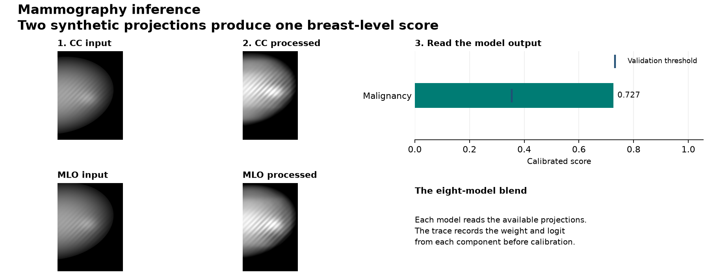

# Follow one mammography prediction

This walkthrough starts with two computer-generated images and ends with the exact score produced by the trained eight-model ensemble. The example can be read in a browser. Running the model locally requires the trained checkpoints from the [reproduction guide](REPRODUCE.md).



## 1. Identify the input and the question

[CC](examples/phantom-cc.png) shows the breast from above. [MLO](examples/phantom-mlo.png) is an angled view. Both inputs come from the same synthetic breast, so the system returns one score. In the study, the question was how well the model ranks malignant versus benign cases among breasts already selected for an annotated lesion.

## 2. Prepare the images

The high-resolution model finds the connected breast region, aligns the chest-wall side, adjusts contrast and fits the result onto a 1,536 × 960 pixel canvas. The middle images above were generated with that same preprocessing code. Other ensemble components use different resolutions or inspect smaller patches. When an image is missing, the view mask tells the model which projection it can use.

## 3. Combine evidence

The [locked model](AUROC.md#training-and-model-selection) combines eight scorers. Some learn from the whole image, others inspect candidate patches or use training lesion masks to learn where to look. A **logit** is the model's internal score. Validation puts the logits on comparable scales and gives each contributor a weight. The [step-by-step trace](examples/paired-trace.json) shows the raw scores, contributions and final calibration.

For this input, the weighted contributions add to **0.3934**. The final calibration maps that to **0.7268**. The validation threshold is **0.3541**, so the example returns `threshold_crossed: true`. The [CC-only run](examples/auroc-cc-only.json) returns **0.6397**. The images are synthetic and these numbers illustrate the scoring workflow.

## 4. Run and check the example

Run the [training and lock commands](REPRODUCE.md) so `$p`, `$hf`, `$experiment`, `$search` and `$evaluation` refer to your trained run. From the repository root, run the paired image example.

```powershell
& $p -m medimage.auc_predict --selection "$evaluation/selection.json" --work $experiment `
    --previous $search --original artifacts --weights $hf --cc examples/phantom-cc.png `
    --mlo examples/phantom-mlo.png --output "$evaluation/phantom-paired.json" `
    --trace "$evaluation/phantom-paired-trace.json"
& $p -m medimage.workflow_figure mammo --examples examples `
    --trace "$evaluation/phantom-paired-trace.json" --output "$evaluation/phantom-workflow.png"
```

Read the `projections` and `threshold_crossed` fields. Remove the `--mlo` option and give the output and trace new names to exercise the one-view path. The reference [paired JSON](examples/auroc-paired.json) and [CC-only JSON](examples/auroc-cc-only.json) came from the published lock. Freshly trained weights can produce different values.

## 5. Check whether the model generalizes

| What can go wrong | How the experiment addresses it |
| --- | --- |
| A patient can contribute both views and multiple annotations | Split by patient and group the views by breast |
| A supplied mark can give away where the lesion is | Use marks to teach the model during training, then score entire views on validation and test |
| One test subset can look better while another gets worse | Report mass and calcification results on the same frozen cohort |
| Trying many blends can overfit validation | Fit each blend on subsets of validation patients and measure it on the other validation patients |

Training teaches the models. Validation chooses models, weights and thresholds. The locked official test estimates how well they generalize. **0.8050 AUROC** means the model usually ranked a randomly chosen malignant breast above a randomly chosen benign breast in this cohort. The 95% interval spans **0.7550–0.8524**. The report includes results from the successive rounds on this same benchmark. [Full benchmark report](AUROC.md)

To see which details can affect a score, open the [before-and-after zoom and region-blur experiment](WHERE-THE-MODEL-LOOKS.md).
