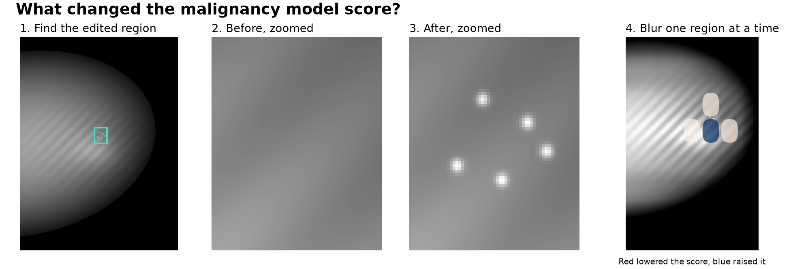

# See the small change and how the model responds

Look for the cluster of five pinpoints in the enlarged patch. A mammographic calcification can appear as a small bright spot, so the example uses a cluster that is easy to compare at the same scale. Begin with the two zooms, then use the colored tiles to see which changes affected the model's score. [NCI guide to reading a mammogram report](https://www.cancer.gov/types/breast/screening/mammograms)



1. The turquoise box marks a cluster of five small, bright spots added to the generated CC projection.
2. The two zooms show the exact same patch before and after adding those spots. The MLO projection stays fixed.
3. The last panel blurs one small region at a time and runs the trained **projection-supervised classifier** again. It measures the change in that component's malignancy score.

**Red** means that blurring the region lowered the score. **Blue** means that blurring it raised the score. Adding the dots changed the component's internal score from **−2.758 to −1.502**. The blue tile near the dots is also a measured effect. Blurring that tile changes the spots and the texture around them, so the two interventions can have different effects. [Edited synthetic input](examples/phantom-edited.png) · [All measured probes](examples/region-evidence.json)

The turquoise box is the known edit location. The heatmap measures how the model uses image texture under these changes. Neither is a location annotated by a radiologist. The [prediction walkthrough](WALKTHROUGH.md) explains how this component contributes to the full ensemble.

## Reproduce the test

Use the trained models and locked selection from the [main reproduction guide](REPRODUCE.md). Without input flags, the command recreates the same synthetic projections. For a local mammogram, pass `--cc` and optionally `--mlo`. The output stays with your local run.

```powershell
& $p -m medimage.visual_explain --selection "$evaluation/selection.json" --work $experiment `
    --weights $hf --component view-supervised --label malignancy_in_lesion_enriched_cohort `
    --output "$evaluation/region-probe"
```
